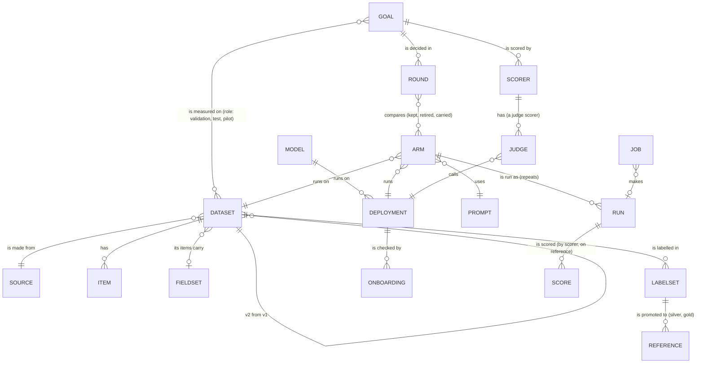

# UXS-005: The Workbench (sketches, round 3)

- **Status**: Draft — sketches for review (owner, 2026-11-06: "agree on the structure … see some sketches … then a
  mock-up"); 0.8.0
- **Authors**: Marko Dragoljevic
- **Related PRDs**: [PRD-017](../prd/PRD-017-workbench.md) (the Workbench: workflows, decisions)
- **Related UX specs**: [UXS-001](UXS-001-catalog.md) (the catalog: shell, tokens), [UXS-002](UXS-002-inspector.md)
  (the inspector), [UXS-003](UXS-003-cli-and-onboarding.md) (commands)

Low-fidelity sketches, in the order a person works (owner, round 1's review: "start from the beginning: you set a
goal, you have a dataset for it, you do something with the dataset, and then you go into the experiment"): an empty
project, the goal, its dataset, preparing the dataset, then models and the experiment. How often a step happens
decides how much thought it gets, never its place in the order. One example runs through it: this repository's
real CNN summaries goal (`news_summary_cnn`: its title, statement, decision and measure) and its dataset from Hugging
Face (`abisee/cnn_dailymail`, the 3.0.0 test split's 11,490 rows, the first 200 the committed runs measured). Values
not read from the project are left out rather than invented; the round sketched at the end is made up to show the
screen.

## The shell

```text
 [eval] Workbench · harness                       Goals   Running (1)   Models   Data   ·  Catalog ↗   ◐
```

- The Workbench is its own app on the catalog's server (`/workbench/`), with the catalog's look (UXS-001) and a
  link to it. Its menu is about doing: **Goals** (home), **Running** (jobs), **Models**, **Data** (datasets, labels,
  references). The catalog stays where results are read.

## 0 An empty project: one way in

```text
 Workbench · my-project                                     Goals   Running   Models   Data   Catalog ↗

            What should this project help you decide?

            An evaluation starts with a goal: the decision you need to make, and how
            you will know which system is better for it.

                                  [ Start with a goal ]

            already have data or runs?  import a dataset · open the catalog
```

- With no goal there is one thing to do. The menu is there, its pages empty with the same single way in.

## 1 The goal

```text
 New goal                                                                       step 1 of 5
 ①Goal ─ ②Dataset ─ ③Prepare ─ ④Models ─ ⑤Experiment

 What is it?  ?     [ Short news summaries (CNN)                                             ]
 What is it for? ?  [ Pick a model that writes a short summary of a CNN-style news article, at ]
                    [ a known cost, for a reader who wants the story's main points.            ]
 The decision ?     [ Which models can be told apart on summary quality, and what each costs   ]
                    [ per article.                                                             ]
 How you'll judge ? measure [ coverage           ▾ ]   (•) higher is better  ( ) lower is better
 How a winner is ?  (•) balanced — not worse than the best, within its margin, then the cheapest
 picked             ( ) frugal   ( ) quality first                         advanced ▸ (margins, axes)

                                                       [ Cancel ]   [ Save and add its dataset → ]
```

- Five things, on one screen; everything else in a goal (axes, tie-breaks, guardrails, output contract, links) is
  "advanced" or comes later from the steps that own it (datasets in step 2, references in step 3).
- The id is made from the title and shown small (`news_summary_cnn`), changeable before saving.
- The measure offers the metrics the project's scorers produce; a new one can be typed.

After saving, the goal's page is the hub of the journey: the same five steps, each with its state and its next action.

```text
 Short news summaries (CNN)                                                  news_summary_cnn
 decides coverage (higher is better) · balanced                                        [edit]

 ①Goal ✓   ②Dataset ○   ③Prepare ○   ④Models ○   ⑤Experiment ○

 ② Dataset   the items the goal is measured on                       [ Add a dataset → ]
```

## 2 The dataset

```text
 Add a dataset to news_summary_cnn                                              step 2 of 5

  Use one you have      [ choose one of the project's datasets      ▾ ]           [ Use it ]
  or make one from:
   [ a folder of files ]  [ a table: CSV, JSON lines ]  [ Hugging Face ]  [ Croissant ]
   [ Zenodo ]  [ OpenML ]  [ Kaggle ]  [ production: a capture ]
```

Making one is four short screens, one decision each:

```text
 a Where from     Hugging Face   repo [ abisee/cnn_dailymail ]  config [ 3.0.0 ]  split [ test ]
                  pinned to the commit it reads (shown once read) · licence apache-2.0   [ Read it → ]

 b What's in it   11,490 rows · columns: article (text), highlights (text), id (text)
                  the item is   [ article ▾ ]   its reference is   [ highlights ▾ ]
                  ┌──────────┬───────────────────────────────────────────┬──────────────────┐
                  │ id       │ article                                   │ highlights        │
                  │ (the first rows as read, not invented here)                                │
                  └──────────┴───────────────────────────────────────────┴──────────────────┘
                  take  (•) the first [ 200 ] rows   ( ) all   ( ) a seeded sample of [ 200 ]

 c Its fields     proposed from the columns                       (a field is what you can slice by)
                  ┌───────────┬────────┬──────────────────────┬──────────┐
                  │ field     │ type   │ values               │ public   │
                  │ (fields proposed from the columns, each with its type and values)    │
                  └───────────┴────────┴──────────────────────┴──────────┘   + add a field

 d Name it        [ cnn_dailymail_200 ]   role for this goal [ test ▾ ]
                  description [ the first 200 test rows ]                 [ Create the dataset ]
```

- Each source asks only what it needs (a folder: its path and which files; a table: its file and columns; a
  capture: which one). Preview before anything is written; fields are a table, proposed, never typed from nothing.
- **Create** is a job (`dataset-create`): it freezes the items and their hashes. The goal's step 2 turns ✓.

## 3 Prepare the dataset

```text
 ③ Prepare  cnn_dailymail_200                                                   step 3 of 5

  a Fetch its items        ✓ materialized · 200 of 200 · hashes match        (dataset-materialize)
  b Look inside            ✓ profiled: 200 items · words per item · each field's values
                           [ open the items ↗ catalog ]
  c Its reference set      the expected answer for each item, that outputs are scored against
                           ( ) it came with one: highlights → promote as  [ gold ▾ ]  [ Promote ]
                           ( ) label it here                          [ Open the labelling screen ]
                           ( ) import labels from a sheet (CSV)       [ Choose a file ]
                           who [ you ]   why [ the dataset's own highlights, as published ]

  Ready when: fetched ✓  looked at ✓  a reference set ✓      [ Next: the models → ]
```

- One screen with the three things a dataset needs before an experiment; each is a job or a small choice, done in
  order, each showing its result.
- **Labelling here** opens the in-app labelling screen (W2, to sketch); a CSV round trip stays the other way in.
- A reference set's promotion records who and why (governance).

## 4 Models (to sketch next)

Bring in a model the experiment will use: what it is, where it runs, onboarded (the probes), approved. A project with
models already onboarded picks from them and skips this step.

## 5 The experiment: a round

The experiment is a round on the goal and its dataset: its arms, their runs and scores, and the decision. This is
where people spend most of their time, so it gets the most thought; round 1's sketch of its board stays as the
starting point:

```text
 news_summary_cnn / round r2 · open (an example)                       budget $5.00 · spent $0.00
 Question  Does a shorter prompt keep coverage at half the cost?                         [edit]

 1  ARMS      rows: clone and change one thing · carry from r1 · new from a model      [ + Add arm ▾ ]
 2  RUN       one button, the estimate first, then progress per job                     [ Run 2 arms ]
 3  RESULTS   the goal's comparison as arms finish; retire · promote baseline · close the round
```

## Help, for someone who is new to this

Owner, round 2's review: "assume that users don't know all these words … a first-time user who got here and never
used this can really find his way without reading the documentation … a vibe coder, a product manager … while if the
person is an engineer and knows all this stuff, let's not make it too childish". A secondary goal of every screen.

### Three layers, always the same

1. **The step says what it is for.** One sentence under each step's title, always shown: what this step does and why
   it comes now ("A dataset is the set of examples your systems will be tested on. Choose it before anything runs:
   every comparison is only as good as its examples.").
2. **Each field has a one-line hint** under it: what to put, with an example from this kind of project. Short enough
   to read without stopping.
3. **A `?` next to a field or a word opens its explanation** in a side panel (not a tooltip that vanishes): what it
   is, why it matters, a real example, what goes wrong if it is wrong, and "read more" into the docs. The panel stays
   open while the person fills the field.

```text
 How you'll judge ?  measure [ coverage ▾ ]  (•) higher is better          ┌─ How you'll judge ─────────────┐
   the number that decides which system is better                          │ A measure is one number per    │
                                                                           │ example: how good one output   │
                                                                           │ is. coverage: how much of the  │
                                                                           │ reference a summary covers when│
                                                                           │ cut to the reference's length, │
                                                                           │ 0 to 1.                        │
                                                                           │ Why it matters: the goal ranks │
                                                                           │ systems by it; pick the one    │
                                                                           │ your decision depends on.      │
                                                                           │ If it is wrong: the "best"     │
                                                                           │ system wins at the wrong thing.│
                                                                           │ Read more: Goals ↗             │
                                                                           └────────────────────────────────┘
```

### Words

- The harness's own words are taught, not replaced: a goal, a dataset, an item, a reference set (gold, silver), an
  arm, a run, a round, a baseline, significant, contenders. The first time a word appears on a screen it is
  underlined lightly; pointing at it (or tapping it) shows its one-line meaning, and its `?` the full one.
- A glossary page holds every word, the same text as the `?` panels, linked from each.

### Not childish

- Plain, exact sentences; the real terms with their meaning, never a cute substitute; no emojis, no exclamation marks,
  no "great job".
- Examples are real (this project's, or a well-known public dataset), never "foo".
- **For someone who knows:** every step shows the command it runs, folded (`evh dataset-create --source huggingface
  --query '{…}' --dataset-id cnn_dailymail_200`); hints can be hidden for good ("hide hints", remembered on this
  browser), the `?` stays; nothing blocks a person who fills the fields straight away.

### Where the help lives

- One file of help texts, keyed by step and field, written and reviewed like the docs; the screens read it.
- A check fails when a field or a step has no hint or no `?` text, so help cannot fall behind the screens.

### Help texts, steps 0 to 3 (first draft)

| Where | Hint (always shown) | `?` panel (the explanation) |
| --- | --- | --- |
| Step 0 | — | **What this is.** An evaluation compares systems (a model, a prompt, a setting) on the same examples, and tells you which is better for a decision you have to make, with how sure it is and what each costs. You start with the decision. |
| Step 1, the goal | A goal is the decision this evaluation helps you make. | Everything later is measured against it: which data, which measure, who wins. One goal per decision; a different purpose is a new goal. |
| What is it? | A short title, as you'd say it to a colleague: "Short news summaries (CNN)". | Shown on every page about this goal. Its id is made from it. |
| What is it for? | One sentence: what you want, for whom, so that what. | It keeps the evaluation honest: a system that is better at something you don't need does not win. Example: "Pick a model that writes a short summary of a CNN-style news article, at a known cost, for a reader who wants the story's main points." |
| The decision | The choice you will make from the result. | "Which models can be told apart on summary quality, and what each costs per article." If the result cannot change this choice, the evaluation is measuring the wrong thing. |
| How you'll judge | The number that decides which system is better, and which way is better. | A measure is one number per example (coverage: how much of the reference a summary covers, cut to the reference's own length, so writing more cannot buy it). Higher or lower is better depends on the measure: quality goes up, cost and time go down. |
| How a winner is picked | Balanced suits most goals. | When systems are close, the rule decides: **balanced** takes the cheapest among those not significantly worse than the best and within its margin; **quality first** takes the best; **frugal** takes the cheapest not significantly worse. Margins and other axes (cost, speed) are under "advanced". |
| Step 2, the dataset | The examples your systems will be tested on. | A dataset is a frozen list of items (an article, a question, a ticket), each with a hash, so every system sees exactly the same examples, now and later. Use one you have, or make one from a source. |
| a Where from | Where the examples are now. | A folder of files, a table (CSV, JSON lines), a dataset on Hugging Face, Croissant, Zenodo, OpenML or Kaggle, or what your system decided in production (a capture). Public sources are read at one pinned version, so the dataset can be rebuilt exactly. |
| b What's in it | Which column is the example, and which holds the expected answer if there is one. | The item is what a system receives (the article). The expected answer (the highlights) becomes the reference later, in step 3. Take a few hundred to start: enough to tell systems apart, cheap to run. |
| c Its fields | Facts about each item you may want to slice by later. | A field (the source: CNN or DailyMail) lets you see whether a system is better on one part of the data. Proposed from the columns; keep the ones you would compare on. |
| d Name it | A short id, and its role for this goal. | The role: **validation** while you choose and tune, **test** for the final answer, kept untouched until then. |
| Step 3, prepare | Three things the dataset needs before anything runs. | Each is done once per dataset. |
| a Fetch its items | Downloads every item and checks it against its hash. | So a run reads exactly the frozen items, offline, every time. |
| b Look inside | What the items are like: how many, how long, each field's values. | Read a few before running anything: most surprises (empty items, the wrong column, a skewed sample) show here. |
| c Its reference set | The expected answer for each item, that outputs are scored against. | Three ways: the data came with answers (promote them), label them here, or bring a filled sheet (CSV). **Gold** is checked by people; **silver** is a model's answers, consistent rather than correct: enough to rank systems against each other, not a claim about truth. Who and why are recorded. |

### Glossary (first draft)

| Word | Meaning |
| --- | --- |
| goal | The decision an evaluation helps you make, and how a winner is picked for it. |
| dataset | A frozen list of items, each with a hash, that every system is tested on. |
| item | One example in a dataset: what a system receives. |
| reference | The expected answer for one item. |
| reference set | The promoted, governed set of references for a dataset: gold (checked by people) or silver (a model's answers, enough to rank systems, not a claim about truth). |
| label, label set | An answer a person, a model or a rule gave for an item; a label set is many of them, which can be promoted to a reference set. |
| field | A fact about each item (its source, its length) you can slice the results by. |
| measure | One number per item that says how good an output is (coverage, accuracy, cost). |
| arm | One system you compare: a model with a prompt and settings, on a dataset. |
| run | One pass of an arm over the dataset: its outputs, their scores, its cost. |
| round | One comparison of arms on a goal and its dataset, from its question to its decision. |
| baseline | The arm the others are measured against: the current choice, or the simplest one. |
| significant | The difference holds up beyond chance, by the paired test (better or worse); "not significant" means it may be noise. |
| contenders | The arms the goal's rule still lets win: not significantly worse than the best, within its margin. |

## The mock data model (round 2: unchanged)

What the screens above show and how it links; the files and the database keep it as they keep it today until the
data-model RFC decides. Reviewed with the mockup (PRD-017, decision 5).



| Entity | What a person sets | What commands write | Today it lives in |
| --- | --- | --- | --- |
| Goal | title, what it is for, the decision, the measure and direction, the winner rule (a named default) | — | `goals/<id>.yaml` |
| Round | its question, budget, which arms; the decision and conclusion | when opened and closed | `rounds/<goal>/<r>.yaml` |
| Dataset | its source, name, fields | items, hashes, version lineage, profile | `datasets/`, `materialized/`, `sources/`, `profiles/` |
| Model / Deployment | what it is, where it runs, endpoint, settings | onboarding, capabilities, smokes, history | `models/<id>.yaml` |
| Arm | dataset, deployment, prompt, the settings it varies | its config id, version | `configs/<id>.yaml` |
| Prompt | its text | its hash | a file named by the config |
| Run | — (it is made by running an arm) | outputs, rows, metrics, cost, fingerprint | `runs*/…` |
| Label set / Reference | labels (in the labelling screen), who and why for a promotion | hashes, counts | `labels/`, `references/` |
| Scorer / Judge | which judges, prompt, mode | validation numbers, verdicts | `scorers/`, `judge-*/` |
| Job | which step to run | status, progress, log, cost | — (new: RFC-026) |

## To review in this round

1. The order: an empty project, the goal (step 1), its dataset (2), preparing it (3), models (4), the experiment (5),
   with the goal's page as the hub that shows the five steps and their state.
2. The goal in five inputs, the rest advanced or owned by later steps.
3. The dataset in four short screens (where from, what's in it, its fields, its name), preview before writing.
4. Preparing as one screen of three things (fetch, look, reference set), with the three ways to a reference set.
5. The data model (unchanged from round 1).
6. The help layer: three layers (the step's sentence, each field's hint, a `?` panel), the words taught with a
   glossary, the command shown folded for someone who knows, and the first draft of the texts for steps 0 to 3.
7. **A word to decide:** step 5 is called "Experiment" here, but the harness's word, agreed 2026-11-02, is **eval**
   (task × dataset), with **round** for one comparison of arms on a goal. Proposed: call step 5 **Round**; keep
   "Experiment" only if you want it.

Not sketched yet: step 4 (models), the experiment in detail, the labelling screen, production (W3).
