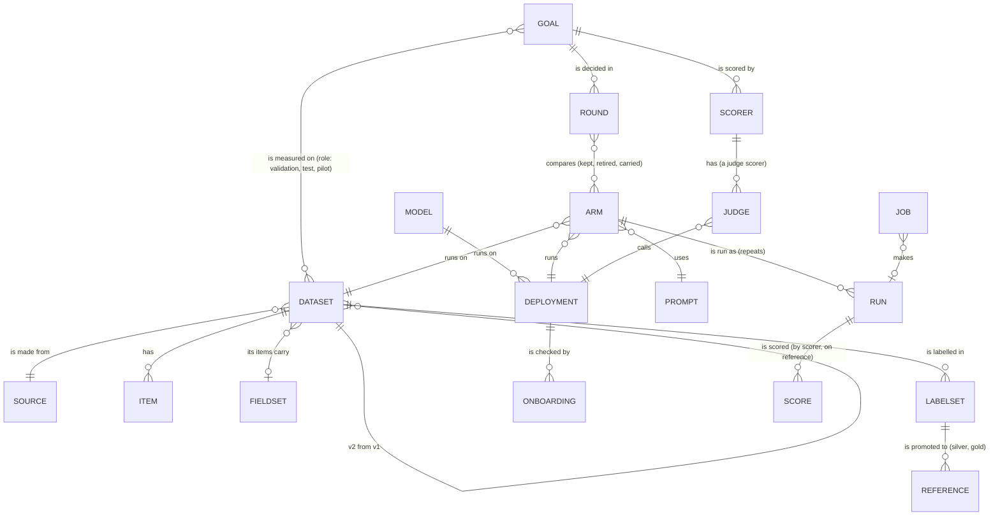

# UXS-005: The Workbench (sketches, round 1)

- **Status**: Draft — sketches for review (owner, 2026-11-06: "agree on the structure … see some sketches … then a
  mock-up"); 0.8.0
- **Authors**: Marko Dragoljevic
- **Related PRDs**: [PRD-017](../prd/PRD-017-workbench.md) (the Workbench: workflows, decisions)
- **Related UX specs**: [UXS-001](UXS-001-catalog.md) (the catalog: shell, tokens), [UXS-002](UXS-002-inspector.md)
  (the inspector), [UXS-003](UXS-003-cli-and-onboarding.md) (commands)

These are low-fidelity sketches of the home and of W1 (run a round), the workflow that gets the most care, with the
mock data model beside them. The examples are this repository's real triage goal (`triage_orrery`, rounds r1–r4,
its baseline, its 65 items and r4's triage_cost 0.446 against 0.872); round r5, its new arms and their numbers are made
up to show the screens.
Once the structure here is agreed, the clickable mockup follows; it is the Workbench's first, static form.

## The shell

```text
 [eval] Workbench · harness                       Goals   Running (1)   Models   Data   ·  Catalog ↗   ◐
```

- The Workbench is its own app on the catalog's server (`/workbench/`), with the catalog's look (UXS-001) and a
  link to it. Its menu is about doing: **Goals** (home), **Running** (jobs), **Models**, **Data** (datasets, labels,
  references). The catalog stays where results are read.

## Home: the goals and their next step

```text
 Goals                                                                           [ + New goal ]

 ┌─ Triage decisions on Orrery's error signals ──────────────────────────────── triage_orrery ─┐
 │  decides triage_cost (lower is better) · frugal                                              │
 │  dataset  orrery_triage_v1_labelled_v2 · 65 items · gold reference                           │
 │  rounds   r1 r2 r3 r4 (closed 2026-11-04)        baseline  production's model (promoted)     │
 │  ▸ Next: open round r5  — r4's leader is not separated from noise_gate                       │
 │                                                   [ Open round r5 ]   [ Review outputs ]     │
 └──────────────────────────────────────────────────────────────────────────────────────────────┘
 ┌─ Short news summaries (CNN) ─────────────────────────────────────────── news_summary_cnn ─┐
 │  decides coverage (higher) · balanced    dataset cnn_dailymail_200 · 200 items · gold        │
 │  rounds r1 (closed)                       ▸ Next: no open round                              │
 └──────────────────────────────────────────────────────────────────────────────────────────────┘
   … one card per goal …

 Running now:  run · triage_prompt_own_code_loads_v2 on orrery…v2 · 41 of 65 items · $0.62 so far  [watch]
```

- A goal card answers three questions: what it decides, what it has (dataset, reference, rounds, baseline), and what
  to do next. The next step comes from the goal's state (no dataset → add one; no reference → label; an open round
  with arms not run → run them; a closed round → open the next).

## W1 Run a round: the round board

One place for a round, from its question to its decision. Three parts on one page, top to bottom.

```text
 triage_orrery / round r5 · open                                        budget $4.00 · spent $0.00
 Question  Does filing the app's own load failures still lead once the noise gate is on?   [edit]
 Dataset   orrery_triage_v1_labelled_v2 · 65 items · gold      Baseline triage_baseline_pro_v2data_v1

 1  ARMS                                                                        [ + Add arm ▾ ]
 ┌────────────────────────────────┬──────────────────┬──────────┬────────┬───────────────────┐
 │ arm                            │ model · prompt   │ status   │ cost   │                   │
 ├────────────────────────────────┼──────────────────┼──────────┼────────┼───────────────────┤
 │ triage_baseline_pro_v2data_v1  │ fleet-pro · c2ec │ carried  │ $1.09  │ baseline          │
 │ triage_prompt_own_code_loads   │ fleet-pro · 219b │ carried  │ $1.10  │                   │
 │ own_code_loads + noise_gate v2 │ fleet-pro · 3a41 │ ready    │ ~$1.05 │ smoke ✓  [clone]  │
 │ own_code_loads · qwen3.8-27b   │ qwen3.8 · 219b   │ new      │ ~$0.00 │ [smoke] [remove]  │
 └────────────────────────────────┴──────────────────┴──────────┴────────┴───────────────────┘
   + Add arm ▾   ·  clone an arm and change one thing (prompt · model · a setting)
                 ·  carry an arm from r4         ·  a new arm from an onboarded model

 2  RUN                                     estimate $2.10 for 2 arms × 3 repeats   [ Run 2 arms ]
    while running:  ███████░░░░  2 jobs · 81 of 130 items · $1.21 · [watch log]

 3  RESULTS AND DECISION                                    scored on gold · paired test vs leader
 ┌────────────────────────────────┬──────────────┬─────────────────────┬──────────────────────┐
 │ arm                            │ triage_cost  │ vs leader           │ contender (≤10%)     │
 │ own_code_loads + noise_gate v2 │ 0.431 ▲best  │ leader              │ yes                  │
 │ triage_prompt_own_code_loads   │ 0.446        │ p 0.44 not separated│ yes                  │
 │ triage_baseline_pro_v2data_v1  │ 0.872        │ p 0.001 worse       │ no                   │
 └────────────────────────────────┴──────────────┴─────────────────────┴──────────────────────┘
   Inspect these arms ↗ (inspector)          Review their outputs → W2
   Decide:  [ Retire … ]  [ Promote baseline … ]  [ Close round with a conclusion … ]
```

- **Arms** are rows, not forms. Adding one is a small choice: clone and change one thing, carry from the last round,
  or new from a model. Its settings open in a side panel with only what that arm varies; the rest is inherited and
  shown greyed.
- **Run** is one button for the arms that are ready, with the estimate first (the dry run) against the round's
  budget; while running, one line per job, and the board stays usable. Each arm is smoked before it can run.
- **Results** fill in as arms finish and are re-scored; the table is the goal's own comparison (the same numbers as
  the catalog's goal page). Deciding is three actions, each asking for its reason in one line.

### Add arm: clone and change one thing

```text
 Clone  triage_prompt_own_code_loads  and change:   ( ) prompt   (•) model   ( ) a setting
   model       [ qwen3.8-27b ▾ ]   onboarded ✓ · x3 · ollama 0.40 · $0
   deployment  [ x3 ▾ ]
   name        own_code_loads · qwen3.8-27b
                                                    [ Cancel ]   [ Add arm and smoke it ]
```

### The arm's side panel

```text
 own_code_loads · qwen3.8-27b                                   [ smoke ✓ 3/3 · read replies ]
 Varies from its source:   model qwen3.8-27b (was fleet-triage-pro)
 Inherits:  prompt 219b34bf · dataset v2 · temperature 0 · reasoning off · repeats 3
 advanced ▸  (every setting, from its config)
```

## The mock data model (round 1)

What the screens above show and how it links; the files and the database keep it as they keep it today until the
data-model RFC decides. Reviewed with the mockup (PRD-017, decision 5).



| Entity | What a person sets | What commands write | Today it lives in |
| --- | --- | --- | --- |
| Goal | title, what it is for, the decision, the measure and direction, the winner rule (a named default) | — | `goals/<id>.yaml` |
| Round | its question, budget, which arms; the decision and conclusion | when opened and closed | `rounds/<goal>/<r>.yaml` |
| Dataset | its source, name, fields | items, hashes, version lineage, profile | `datasets/`, `materialized/`, `sources/`, `profiles/` |
| Model / Deployment | what it is, where it runs, endpoint, settings | onboarding, capabilities, smokes, history | `models/<id>.yaml` |
| Arm | dataset, deployment, prompt, the settings it varies | its config id, version | `configs/<id>.yaml` |
| Prompt | its text | its hash | a file named by the config |
| Run | — (it is made by running an arm) | outputs, rows, metrics, cost, fingerprint | `runs*/…` |
| Label set / Reference | labels (in the labelling screen), who and why for a promotion | hashes, counts | `labels/`, `references/` |
| Scorer / Judge | which judges, prompt, mode | validation numbers, verdicts | `scorers/`, `judge-*/` |
| Job | which step to run | status, progress, log, cost | — (new: RFC-026) |

## To review in this round

1. The shell's menu (Goals, Running, Models, Data) and the home as goal cards with a next step.
2. The round board's three parts on one page (arms, run, results and decision), and arms as rows with a side panel.
3. "Clone and change one thing" as the main way to add an arm.
4. The data model's entities and links; in particular Prompt and Job as entities of their own, and Arm separate from
   its config file.

Not sketched yet: W2 (review and labels: the in-app labelling screen), W3 (production), W4–W7, Running, Models, Data.
