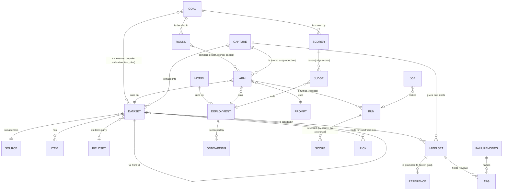

# UXS-005: The Workbench (sketches round 3, mockup round 4)

- **Status**: Draft — sketches and the clickable mockup for review (owner, 2026-11-06: "agree on the structure … see
  some sketches … then a mock-up"; 2026-11-08: "complete the mock-up really with everything we've been saying"); 0.8.0
- **Authors**: Marko Dragoljevic
- **Related PRDs**: [PRD-017](../prd/PRD-017-workbench.md) (the Workbench: workflows, decisions)
- **Related UX specs**: [UXS-001](UXS-001-catalog.md) (the catalog: shell, tokens), [UXS-002](UXS-002-inspector.md)
  (the inspector), [UXS-003](UXS-003-cli-and-onboarding.md) (commands)

Low-fidelity sketches, in the order a person works (owner, round 1's review: "start from the beginning: you set a
goal, you have a dataset for it, you do something with the dataset, and then you go into the experiment"): an empty
project, the goal, its dataset, preparing the dataset, then models and the eval. How often a step happens
decides how much thought it gets, never its place in the order. One example runs through it: this repository's
real CNN summaries goal (`news_summary_cnn`: its title, statement, decision and measure) and its dataset from Hugging
Face (`abisee/cnn_dailymail`, the 1.0.0 test split's 11,490 rows, the first 200 the committed runs measured). Values
not read from the project are left out rather than invented; the round sketched at the end is made up to show the
screen.

## The mockup

The mockup is the Workbench's first, static form (owner: "the mock-up is already the workbench app you're starting,
just static"): `harness/workbench/` (`index.html`, `workbench.css`, `workbench.js` for the shell and the five steps,
`workflows.js` for the other workflows, `help.js` for every hint, `?` panel and word).

- **Its data is read, never invented.** `harness/workbench/mock_data.py` writes `mock.js` from the project: the goals,
  datasets, models and their onboarding, the CNN source, items, references and profile, the rounds, every arm's
  scores, settings and first replies, the silver reference and who wrote it, the judge and its validation, and the
  triage goal's capture and comparison, the rows where production was wrong, the label sheet, the local arms' re-runs
  and their paired tests. Several inputs are the harness's own answers, saved first because they take minutes (`evh
  models`, `evh goals`, `evh pair-test`, `evh inspect --sheet --wrong-against`, `evh label-sheet`; the list is at the
  top of the script). `harness/workbench/read_sources.py` reads every other dataset source with the example its module
  documents, through the harness's own source classes, writing nothing to the project.
- **What it pretends is labelled.** Jobs and saving are pretended; each place says so in a "mockup:" note, which a
  switch hides. In a round opened in the walk-through, a local arm shows its own real re-run (the project's Linux
  re-runs, compared with bart_l's by `evh pair-test`); a hosted arm, which the project never re-ran, shows its r1 run
  and says so; a clone has no run.
- It walks from an empty project to a closed round and through every workflow below; state is kept per browser, and
  "start over" clears it.

## The shell

```text
 evh workbench · project: harness          Home   Models   Jobs   Settings   Words   Catalog ↗   [x] hints   ◐

 GOAL                       │
 Short news summaries (CNN) │   (the screen)
  ≡ Overview                │
  ✓ Goal                    │
  ✓ Dataset                 │
  ✓ Prepare                 │
  4 Models                  │
  5 Eval                    │
 DAY TO DAY                 │
  · Review and label        │
  · Production              │
  · A judge                 │
```

- The Workbench is its own app on the catalog's server (`/workbench/`), with the catalog's look (UXS-001, its tokens,
  dark first) and a link to it. Its menu is about doing: **Home** (the goals), **Models** (bring one in), **Jobs**,
  **Settings** (W8), **Words** (the glossary). The catalog stays where results are read.
- Inside a goal a rail shows its five steps with their state, and under them the goal's day-to-day work: reviewing and
  labelling (W2), production (W3), its judge (W7).
- A `?` opens a side panel (a sheet at the bottom on a phone); "hints" hides the one-line hints for good.

## 0 An empty project: one way in

```text
 evh workbench · project: my-project       Home   Models   Jobs   Settings   Words   Catalog ↗   [x] hints   ◐

            What should this project help you decide?

            An evaluation starts with a goal: the decision you need to make, and how
            you will know which system is better for it.

                                  [ Start with a goal ]

            already have data or runs?  import a dataset · open the catalog
```

- With no goal there is one thing to do. The menu is there, its pages empty with the same single way in.

## 1 The goal

```text
 New goal                                                                       step 1 of 5
 ①Goal ─ ②Dataset ─ ③Prepare ─ ④Models ─ ⑤Eval

 What is it?  ?     [ Short news summaries (CNN)                                             ]
 What is it for? ?  [ Pick a model that writes a short summary of a CNN-style news article, at ]
                    [ a known cost, for a reader who wants the story's main points.            ]
 The decision ?     [ Which models can be told apart on summary quality, and what each costs   ]
                    [ per article.                                                             ]
 How you'll judge ? measure [ coverage           ▾ ]   (•) higher is better  ( ) lower is better
 How a winner is ?  (•) balanced — not worse than the best, within its margin, then the cheapest
 picked             ( ) frugal   ( ) quality first                         advanced ▸ (margins, axes)

                                                       [ Cancel ]   [ Save and add its dataset → ]
```

- Five things, on one screen; everything else in a goal (axes, tie-breaks, guardrails, output contract, links) is
  "advanced" or comes later from the steps that own it (datasets in step 2, references in step 3).
- The id is made from the title and shown small (`news_summary_cnn`), changeable before saving.
- The measure offers the metrics the project's scorers produce; a new one can be typed.

After saving, the goal's page is the hub of the journey: the same five steps, each with its state and its next action.

```text
 Short news summaries (CNN)                                                  news_summary_cnn
 decides coverage (higher is better) · balanced                                        [edit]

 ①Goal ✓   ②Dataset ○   ③Prepare ○   ④Models ○   ⑤Eval ○

 ② Dataset   the items the goal is measured on                       [ Add a dataset → ]
```

## 2 The dataset

```text
 Add a dataset to news_summary_cnn                                              step 2 of 5

  Use one you have      [ choose one of the project's datasets      ▾ ]           [ Use it ]
  or make one from:
   [ a folder of files ]  [ a table: CSV, JSON lines ]  [ Hugging Face ]  [ Croissant ]
   [ Zenodo ]  [ OpenML ]  [ Kaggle ]  [ production: a capture ]
```

Making one is four short screens, one decision each:

```text
 a Where from     Hugging Face   repo [ abisee/cnn_dailymail ]  config [ 1.0.0 ]  split [ test ]
                  pinned to 690bb95 · licence apache-2.0                          [ Read it → ]

 b What's in it   11,490 rows · columns: article (text), highlights (text), id (text)
                  the item is   [ article ▾ ]   its reference is   [ highlights ▾ ]
                  ┌──────────┬───────────────────────────────────────────┬──────────────────┐
                  │ id       │ article                                   │ highlights        │
                  │ (the first rows as read, not invented here)                                │
                  └──────────┴───────────────────────────────────────────┴──────────────────┘
                  take  (•) the first [ 200 ] rows   ( ) all   ( ) a seeded sample of [ 200 ]

 c Its fields     proposed from the columns                       (a field is what you can slice by)
                  ┌───────────┬────────┬──────────────────────┬──────────┐
                  │ field     │ type   │ values               │ public   │
                  │ (fields proposed from the columns, each with its type and values)    │
                  └───────────┴────────┴──────────────────────┴──────────┘   + add a field

 d Name it        [ cnn_dailymail_200 ]   role for this goal [ test ▾ ]
                  description [ the first 200 test rows ]                 [ Create the dataset ]
```

- Each source asks only what it needs, its own query (the sources' modules document them):

  | Source | Where from asks |
  | --- | --- |
  | a folder | `path`, `glob` (which files), `recursive` |
  | a table | `path`: a .csv or .jsonl with `item_id`, `source_url` and field columns |
  | Hugging Face | `ref`, `config`, `split`, then `text`, `id`, `fields`, `limit` |
  | Croissant | `url` or `path`, `record_set`, `text`, `id` |
  | Zenodo | `record`, `file`, `text` |
  | OpenML | `dataset`, `text` |
  | Kaggle | `ref`, `version`, `file`, `text` |
  | production | which capture, which records (`FIELD:VALUE`), one per a field (`dataset-from-capture`) |

- Preview before anything is written; fields are a table, proposed, never typed from nothing.
- **New:** the expected answer's column (b). The Hugging Face source takes the item's column and its id today, not an
  answer column; the mockup marks it as new.
- In the mockup each source is read for real with the example its module documents: a folder (`data/sources/
  cnn_dailymail_20`), Zenodo (record 10157504, `sts_gold_tweet.csv`), Kaggle (`uciml/iris`), Hugging Face; OpenML
  answered HTTP 503 on 2026-11-08 and the screen shows that answer; Croissant shows the refusal the source gives the
  harness's own export (a text dataset's items are a FileSet, which the source does not read); the table source shows
  that the project has no manifest to read. Reading them found that the Zenodo source documented a record without the
  file it named; its example is now one that reads.
- **Create** is a job (`dataset-create`): it freezes the items and their hashes. The goal's step 2 turns ✓.

## 3 Prepare the dataset

```text
 ③ Prepare  cnn_dailymail_200                                                   step 3 of 5

  a Fetch its items        ✓ materialized · 200 of 200 · hashes match        (dataset-materialize)
  b Look inside            ✓ profiled: 200 items · words per item · each field's values
                           [ open the items ↗ catalog ]
  c Its reference set      the expected answer for each item, that outputs are scored against
                           ( ) it came with one: highlights → promote as  [ gold ▾ ]  [ Promote ]
                           ( ) label it here                          [ Open the labelling screen ]
                           ( ) import labels from a sheet (CSV)       [ Choose a file ]
                           who [ you ]   why [ the dataset's own highlights, as published ]

  Ready when: fetched ✓  looked at ✓  a reference set ✓      [ Next: the models → ]
```

- One screen with the three things a dataset needs before an eval; each is a job or a small choice, done in
  order, each showing its result.
- **Labelling here** opens the labelling screen (below, W2); a CSV round trip stays the other way in.
- A reference set's promotion records who and why (governance).
- Once there is one, **Change the reference set** (W6, below) shows what a new one moves before anything is re-scored.

## 4 Models

```text
 Choose the models to compare                                                  step 4 of 5

 a Pick the models    (•) run on this goal before (28)   ( ) every model in the project (64)
   [ ] model                 kind  weights      onboarding        arms  on this goal
   [x] deepseek-4.1-flash    llm   open         pass 2026-10-31   19    #2 of 29
   [x] eval-llama-maverick   llm   open         none              12    #3 of 29
       …                                                   [ Bring a model that isn't here ]
 b Their settings     the prompt (the same for every arm) · temperature 0 · at most 1200 tokens
 c Check each on three items                                         [ Check 3 arms on 3 items ]
   deepseek-4.1-flash  arm deepseek_m   3 replies · spent $0.00092 · all 200 ≈ $0.04       ▸
     item 1 · its reply · 2.0 s          │ the reference · coverage 0.47

 Ready when: at least two arms checked (3)                              [ Next: the eval → ]
```

- Models come from the project's records with their onboarding: **pass** (probed and passed), **probed** (nothing
  flagged, not yet run on an arm), **check** (a probe flagged something to read), **none** (never probed: run before
  onboarding existed). A model that is not there is brought in (W5).
- One prompt and one set of settings for every arm, so a difference in the scores is the model's. ML models (BART)
  carry their own settings.
- The three-item check (`arm-smoke`) shows each arm's replies beside the reference, what they cost and what all items
  would cost, before anything is compared. In the mockup the replies, cost and timing are the r1 run's real first
  three items.

## 5 The eval: its rounds

The eval is the goal measured on its dataset, in rounds: each round asks one question, compares its arms, and ends in a
decision kept with its reason. This is where people spend most of their time (W1), so it gets the most thought.

```text
 The eval                                            news_summary_cnn · cnn_dailymail_200
 THE ANSWER SO FAR · baseline bart_l
 bart_l (BART-large-CNN, MIT, $0 on a CPU) leads on coverage at 0.3461, not significantly different from
 deepseek_m (0.3460, p = 0.99), for CNN-style text; rent deepseek_m if you need speed.

 ( r1 · closed )  ( r2 · closed )  ( r3 · closed )                                   [ Open round r4 ]

 Which of 24 hosted LLMs (8 vendors × 3 price tiers) and local BART summarisers covers a CNN article's
 gold highlights best, and at what cost?
 The comparison ?                       29 arms · 200 items · scored against gold/cnn_dailymail_200
   coverage ↑  ●  bart_l      ● deepseek_m        │ What the goal's rule picks: balanced — none could be
               ●●  ●  ● ●  ●   ●     ●     ●      │ shown within the margin, so the leader stands: bart_l.
               $0      $100     $1,000   $10,000   │ Detectable: … only within about 0.0363; this goal's
                     cost per 1M articles (log)    │ margin is 0.01731: raise it, compare fewer, add items.
   #  arm          coverage      vs the leader             per 1M articles   per article
   1  bart_l  baseline recommended  0.346  leader          $0                10.7 s
   2  deepseek_m   0.346         not significant p 0.9923  $191              1.5 s
   …                                              [ Show the 13 significantly worse ]
 Its conclusion                                              promoted cnn_bart_l_n200_v1
```

- **Reading a round:** the question, the comparison as a chart (coverage against cost) and a table (the paired test
  against the leader, cost, speed), what the goal's rule picks and why, and what these items can show at all (the
  harness's own "detectable" line). Selecting an arm opens its settings, cost and its summaries beside the reference.
  The significantly worse are folded.
- **A round of one's own (W1):**

```text
 round r4 · open · from r1
 The round's question ?  [ Does a cheaper hosted model match bart_l's coverage on CNN?               ]
 1 Its arms      bart_l (baseline, carried, not re-run) · deepseek_m $0.04 · llama_l $0.04 · …
                 ▸ Clone an arm and change one thing   [ deepseek_m ▾ ] [ the prompt ▾ ] [ its new value ]
 2 Run           [ Run 4 arms · about $0.35 ]          the dry run's estimate first; jobs on the server
 3 Results       arm  coverage  vs the leader  per 1M   retire · make baseline (each with its reason)
                 The conclusion [ … ]                               [ Close the round ]
```

  The arms come from step 4; the baseline is carried, not re-run; a clone changes one thing so its difference is that
  change's. The estimate is each arm's r1 cost per item × 200 in the mockup (`run --dry-run` in the real one).
  Retiring and making a baseline each record a reason; closing records the conclusion and promotes the baseline's run.
  From here: score with a judge (W7), review the outputs (W2).

## The other workflows

### Home

```text
 Your goals
 Running now          Nothing is running.                                         every job →
 goal                                  decides             datasets  rounds      reference sets  next
 Short news summaries (CNN)            coverage (higher)   1         4           gold/…          review the outputs →
 Triage decisions on Orrery's …  deployed  triage_cost (lower)  2   4 · last r4  2               learn from production →
```

- Every goal with where it stands and its next step, and what is running across goals (PRD-017, requirement 1). The
  mockup lists the walk-through's goal, then this repository's seven goals as they stand.

### Jobs

- Every step that runs is a job: its cost first, then progress and the log, then its result. A job keeps running when
  the page closes; it can be stopped, and resumed where its command allows (`run --resume`). The list shows each job,
  its status, when it started and how far it is.

### W2 Review and label

```text
 Review the outputs                                       compare [ bart_l ▾ ] with [ deepseek_m ▾ ]  [x] hide which is which
 ‹ item 1 of 3 · row 0 ›                ▸ the article and its reference
 A                                       │ B
 The Palestinian Authority becomes …     │ The Palestinian Authority became …
 Which is better   ( ) A  ( ) B  ( ) the same  ( ) neither is good
 What went wrong   [narration] [label] [markdown] [bullets] [paragraphs] [overlong] [truncated]  + a mode
 A note            [ anything a number would miss ]                                  [ Save and next ]
```

- Two arms' outputs on the same item; the sides are shuffled and the scores hidden while arms are hidden, so the pick
  is not swayed. Picks, tags and notes are a label set with who made them (`inspect --sheet … --fill pick`,
  `sheet-import`).
- The failure modes are a named list, so tags are counted; the first list is proposed from the eval's own format
  checks (the CNN adapter's narration, label, markdown, bullets, paragraphs, overlong, truncated).
- **Labelling the items** (the expected answer) is the same screen's other half: the item, a box for its answer
  ("start from its highlights" when the data has one), save and next; or the sheet: download it, fill it elsewhere,
  drop it back, checked before anything is kept (`label-sheet`, `label-import`): its columns, each item id against the
  dataset's, an answer per row; unknown ids are refused and named. Labels then go to a reference set (W6). The mockup
  holds the real 200-row sheet and checks a dropped one in the page.

### W3 Production

```text
 Triage decisions on Orrery's error signals · production
 1 What it decided         233 decisions captured · 2026-07-25 to 2026-10-29 · captured 2026-11-04
 2 Against people's labels  triage_prompt_own_code_loads_v1  0.446  recommended
                            triage_baseline_pro_v2data_v1    0.872  production's model  +0.426, p 0.0014, worse
 3 Pick the rows for the next version   ( ) wrong against the labels  ( ) new since …  ( ) not labelled yet
 4 The next dataset version             [ Make the next version ]
```

- A goal that is not deployed says so and what will show once it is. The mockup shows production on this project's
  deployed goal (triage): its capture, production's decisions scored like an arm against people's labels, the 30
  decisions where production's model disagreed with the owner's labels (what it decided, what people decided, its
  cost), the picks (checked rows, one reason) and the next dataset version made from them (`arm-from-capture`, `label-from-capture`,
  `inspect --wrong-against`, `pick`, `dataset-extend`).

### W5 Bring in a model

- What it is and where it runs (a hosted gateway, a machine of ours, inside the harness), its address, weights and
  licence; then **onboard**: the probes run as a job and their findings are shown, never typed (answers, thinks before
  answering, with the chosen settings, speed, the same answer twice, valid JSON); then **approve** with who and why.
  A **check** is read before approving. In the mockup the findings are `deepseek-4.1-flash`'s (pass) and
  `ministral-3-14b`'s (check: "the JSON probe's answer is not valid JSON") real onboarding.

### W6 Change the reference set

- Choose the new reference set, see **what it moves** (the arms ranked on it beside their rank on the current one),
  then promote it with who and why and re-score the arms ($0: stored outputs). In the mockup: the CNN silver set,
  written by the arm `anthropic_l`, puts anthropic_m first (0.491) and makes deepseek_m significantly worse (p 0.0087);
  the two arms that rise most are the author's own family, which the screen says before promoting.

### W7 A judge

- Its judges (two families at least, from onboarded models), how it judges (grade each, rank a block, pick the better
  of two), its prompt, its guards and its cost cap; **does it agree with people** (its validation against the best free
  scorer, and on a CNN set where people chose the best summary); then a dry run for the cost and the scoring as a job.
  In the mockup: `judge-summ-v2` (openai_l, anthropic_l), tau 0.540 and 0.528 on SummEval against 0.372 for the best
  free scorer, best pick on Goyal 2022's CNN set 0.52 and 0.54 against 0.33 by chance, at most $15.00.

### W8 Settings

- Rare, so terse, one row each with its command: where the project keeps its data (`data-migrate`), checking the
  project (`validate`, a job), committed runs and their floors, the goal policy, budgets, publishing a dataset.

## Help, for someone who is new to this

Owner, round 2's review: "assume that users don't know all these words … a first-time user who got here and never
used this can really find his way without reading the documentation … a vibe coder, a product manager … while if the
person is an engineer and knows all this stuff, let's not make it too childish". A secondary goal of every screen.

### Three layers, always the same

1. **The step says what it is for.** One sentence under each step's title, always shown: what this step does and why
   it comes now ("A dataset is the set of examples your systems will be tested on. Choose it before anything runs:
   every comparison is only as good as its examples.").
2. **Each field has a one-line hint** under it: what to put, with an example from this kind of project. Short enough
   to read without stopping.
3. **A `?` next to a field or a word opens its explanation** in a side panel (not a tooltip that vanishes): what it
   is, why it matters, a real example, what goes wrong if it is wrong, and "read more" into the docs. The panel stays
   open while the person fills the field.

```text
 How you'll judge ?  measure [ coverage ▾ ]  (•) higher is better          ┌─ How you'll judge ─────────────┐
   the number that decides which system is better                          │ A measure is one number per    │
                                                                           │ example: how good one output   │
                                                                           │ is. coverage: how much of the  │
                                                                           │ reference a summary covers when│
                                                                           │ cut to the reference's length, │
                                                                           │ 0 to 1.                        │
                                                                           │ Why it matters: the goal ranks │
                                                                           │ systems by it; pick the one    │
                                                                           │ your decision depends on.      │
                                                                           │ If it is wrong: the "best"     │
                                                                           │ system wins at the wrong thing.│
                                                                           │ Read more: Goals ↗             │
                                                                           └────────────────────────────────┘
```

### Words

- The harness's own words are taught, not replaced: a goal, a dataset, an item, a reference set (gold, silver), an
  arm, a run, a round, a baseline, significant, contenders. The first time a word appears on a screen it is
  underlined lightly; pointing at it (or tapping it) shows its one-line meaning, and its `?` the full one.
- A glossary page holds every word, the same text as the `?` panels, linked from each.

### Not childish

- Plain, exact sentences; the real terms with their meaning, never a cute substitute; no emojis, no exclamation marks,
  no "great job".
- Examples are real (this project's, or a well-known public dataset), never "foo".
- **For someone who knows:** every step shows the command it runs, folded (`evh dataset-create --source huggingface
  --query '{…}' --dataset-id cnn_dailymail_200`); hints can be hidden for good ("hide hints", remembered on this
  browser), the `?` stays; nothing blocks a person who fills the fields straight away.

### Where the help lives

- One file of help texts, keyed by step and field, written and reviewed like the docs; the screens read it.
- A check fails when a field or a step has no hint or no `?` text, so help cannot fall behind the screens.

### Help texts (first draft)

| Where | Hint (always shown) | `?` panel (the explanation) |
| --- | --- | --- |
| Step 0 | — | **What this is.** An evaluation compares systems (a model, a prompt, a setting) on the same examples, and tells you which is better for a decision you have to make, with how sure it is and what each costs. You start with the decision. |
| Step 1, the goal | A goal is the decision this evaluation helps you make. | Everything later is measured against it: which data, which measure, who wins. One goal per decision; a different purpose is a new goal. |
| What is it? | A short title, as you'd say it to a colleague: "Short news summaries (CNN)". | Shown on every page about this goal. Its id is made from it. |
| What is it for? | One sentence: what you want, for whom, so that what. | It keeps the evaluation honest: a system that is better at something you don't need does not win. Example: "Pick a model that writes a short summary of a CNN-style news article, at a known cost, for a reader who wants the story's main points." |
| The decision | The choice you will make from the result. | "Which models can be told apart on summary quality, and what each costs per article." If the result cannot change this choice, the evaluation is measuring the wrong thing. |
| How you'll judge | The number that decides which system is better, and which way is better. | A measure is one number per example (coverage: how much of the reference a summary covers, cut to the reference's own length, so writing more cannot buy it). Higher or lower is better depends on the measure: quality goes up, cost and time go down. |
| How a winner is picked | Balanced suits most goals. | When systems are close, the rule decides who may still win beside the best (the contenders); among them the cheapest wins, then the fastest. **Balanced**: shown no worse than the best by more than 5% of it (a non-inferiority test). **Quality first**: the same quality only. **Frugal**: shown no worse by more than 10%. The margin, the tie-break and other measures are under "advanced". |
| Step 2, the dataset | The examples your systems will be tested on. | A dataset is a frozen list of items (an article, a question, a ticket), each with a hash, so every system sees exactly the same examples, now and later. Use one you have, or make one from a source. |
| a Where from | Where the examples are now. | A folder of files, a table (CSV, JSON lines), a dataset on Hugging Face, Croissant, Zenodo, OpenML or Kaggle, or what your system decided in production (a capture). Public sources are read at one pinned version, so the dataset can be rebuilt exactly. |
| b What's in it | Which column is the example, and which holds the expected answer if there is one. | The item is what a system receives (the article). The expected answer (the highlights) becomes the reference later, in step 3. Take a few hundred to start: enough to tell systems apart, cheap to run. |
| c Its fields | Facts about each item you may want to slice by later. | A field (the source: CNN or DailyMail) lets you see whether a system is better on one part of the data. Proposed from the columns; keep the ones you would compare on. |
| d Name it | A short id, and its role for this goal. | The role: **validation** while you choose and tune, **test** for the final answer, kept untouched until then. |
| Step 3, prepare | Three things the dataset needs before anything runs. | Each is done once per dataset. |
| a Fetch its items | Downloads every item and checks it against its hash. | So a run reads exactly the frozen items, offline, every time. |
| b Look inside | What the items are like: how many, how long, each field's values. | Read a few before running anything: most surprises (empty items, the wrong column, a skewed sample) show here. |
| c Its reference set | The expected answer for each item, that outputs are scored against. | Three ways: the data came with answers (promote them), label them here, or bring a filled sheet (CSV). **Gold** is checked by people; **silver** is a model's answers, consistent rather than correct: enough to rank systems against each other, not a claim about truth. Who and why are recorded. |
| Step 4, models | The systems you compare. Each is checked on three items before it costs anything. | A model with its prompt and settings, run on this dataset, is an arm. A model that fails on three items would fail on all of them, and you would pay for every one. |
| Pick the models | Models already in this project are ready to use; a new one is onboarded once, for every goal. | Onboarding probes a model once: does it answer, how it counts tokens, what it costs, whether it thinks first. pass, probed, check, none. A model with an unread check can fail mid-run, after it has cost money. |
| Their settings | What every arm is given: the prompt, the temperature, the most it may write. | The same for every model, so a difference in the scores is the model's. Change one thing at a time. |
| Check each on three items | Runs each arm on the first three items, the way the full run would, and shows the replies. | An empty, cut-off or wrongly formatted reply shows here for a few cents; the cost of three projects the cost of all. |
| Step 5, the eval | The goal measured on its dataset, in rounds. | Each round asks one question, runs its arms, compares them by the goal's measure and rule, and ends in a decision kept with its reason. |
| The round's question | What this round should find out, in one sentence. | "Does a shorter prompt keep coverage at half the cost?" A round without a question collects runs, not answers. |
| The comparison | Every arm against the best, by the paired test, with what each costs and how fast it is. | "not significant" means the difference may be noise; "significant: worse" means it holds up. Reading the order of the means alone misleads: most neighbours are not significantly different. |
| What this comparison can show | How small a difference these items can tell apart, for this many arms. | With many arms on few items only large differences can be shown; it says what to change: raise the margin, compare fewer arms, or add items. |
| Close the round | What the round showed and what it decided, and the run that becomes the baseline if one does. | The conclusion is kept with the round and shown wherever its goal is. |

### Glossary (first draft)

| Word | Meaning |
| --- | --- |
| goal | The decision an evaluation helps you make, and how a winner is picked for it. |
| dataset | A frozen list of items, each with a hash, that every system is tested on. |
| item | One example in a dataset: what a system receives. |
| reference | The expected answer for one item. |
| reference set | The promoted, governed set of references for a dataset: gold (checked by people) or silver (a model's answers, enough to rank systems, not a claim about truth). |
| label, label set | An answer a person, a model or a rule gave for an item; a label set is many of them, which can be promoted to a reference set. |
| field | A fact about each item (its source, its length) you can slice the results by. |
| measure | One number per item that says how good an output is (coverage, accuracy, cost). |
| arm | One system you compare: a model with a prompt and settings, on a dataset. |
| run | One pass of an arm over the dataset: its outputs, their scores, its cost. |
| round | One comparison of arms on a goal and its dataset, from its question to its decision. |
| baseline | The arm the others are measured against: the current choice, or the simplest one. |
| significant | The difference holds up beyond chance, by the paired test (better or worse); "not significant" means it may be noise. |
| contenders | The arms the goal's rule still lets win: not significantly worse than the best, within its margin. |
| eval | The goal measured on its dataset, in rounds. |
| validation, test | A dataset's role: validation while you choose and tune; test for the final answer, kept untouched until then. |
| gold, silver | A reference set checked by people; one made of a model's answers, enough to rank systems, not a claim about truth. |
| onboarding | Probing a model once, for every goal: does it answer, how it counts tokens, what it costs. Kept in its record. |
| coverage | How much of the reference a summary covers, cut to the reference's own length, 0 to 1. |
| capture | What a deployed system decided, kept as records with their hashes, to evaluate and learn from. |
| pick | A production record chosen for the next version of a dataset, with the reason it was chosen. |
| judge | A model that scores outputs the way a person would; it may decide only after agreeing with people's labels. |
| failure mode | A named way an output can be wrong (overlong, narration), so tags are counted rather than re-invented in each note. |

## The mock data model (round 3)

What the screens above show and how it links; the files and the database keep it as they keep it today until the
data-model RFC decides. Reviewed with the mockup (PRD-017, decision 5).



| Entity | What a person sets | What commands write | Today it lives in |
| --- | --- | --- | --- |
| Goal | title, what it is for, the decision, the measure and direction, the winner rule (a named default) | — | `goals/<id>.yaml` |
| Round | its question, budget, which arms; the decision and conclusion | when opened and closed | `rounds/<goal>/<r>.yaml` |
| Dataset | its source, name, fields | items, hashes, version lineage, profile | `datasets/`, `materialized/`, `sources/`, `profiles/` |
| Model / Deployment | what it is, where it runs, endpoint, settings | onboarding, capabilities, smokes, history | `models/<id>.yaml` |
| Arm | dataset, deployment, prompt, the settings it varies | its config id, version | `configs/<id>.yaml` |
| Prompt | its text | its hash | a file named by the config |
| Run | — (it is made by running an arm) | outputs, rows, metrics, cost, fingerprint | `runs*/…` |
| Label set / Reference | labels (in the labelling screen), who and why for a promotion | hashes, counts | `labels/`, `references/` |
| Scorer / Judge | which judges, prompt, mode | validation numbers, verdicts | `scorers/`, `judge-*/` |
| Job | which step to run | status, progress, log, cost | — (new: RFC-026) |
| Capture | which deployment, since when | its records and their hashes | `captures/<id>/` |
| Pick | which record, for which dataset, why | when, by whom | the picks (`evh picks`) |
| Failure modes / Tag | the list of modes; a tag on an output (in review) | counts per arm | `failure-modes/<id>.yaml`, a label set |

## To review in this round

1. The order: an empty project, the goal (step 1), its dataset (2), preparing it (3), models (4), the eval (5),
   with the goal's page as the hub that shows the five steps and their state.
2. The goal in five inputs, the rest advanced (the margin, the tie-break, other measures) or owned by later steps.
3. The dataset in four parts (where from, what's in it, its fields, its name), the same for every source, preview
   before writing.
4. Preparing as one screen of three things (fetch, look, reference set), with the three ways to a reference set.
5. Models: pick with their onboarding, one set of settings, three items checked before anything is compared.
6. The eval: the answer so far, its rounds, the comparison (chart, table, what the rule picks, what the items can
   show), an arm's summaries; a round of one's own (question, arms from step 4 and clones, the dry run's estimate,
   run, results, retire and make baseline with a reason, close).
7. The day-to-day work under each goal: review and label (W2), production (W3), a judge (W7); and home, jobs,
   bringing in a model (W5), changing the reference set (W6), settings (W8).
8. The help layer: three layers, the words with a glossary, the command folded; the texts for steps 0 to 5.
9. The data model, with captures, picks, failure modes and tags added.

Not in the mockup yet: a hosted arm's new run (the project has none; one would be a paid call, from about $0.04 for
deepseek_m's 200 items); OpenML's rows (it answered HTTP 503 when read); a Croissant description the source can read
(none in the project; the harness's own export is refused); a table source's rows (no manifest in the project).
